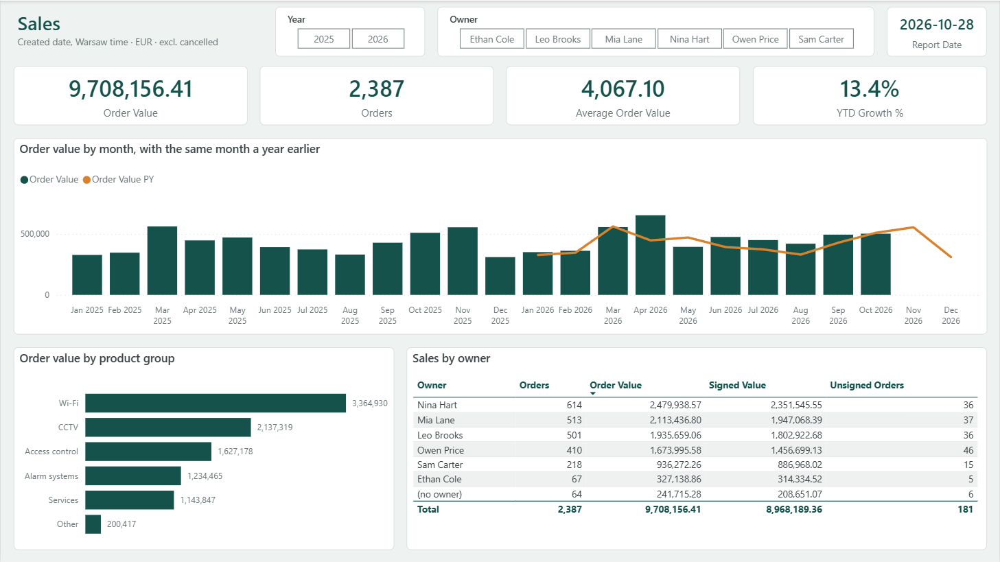
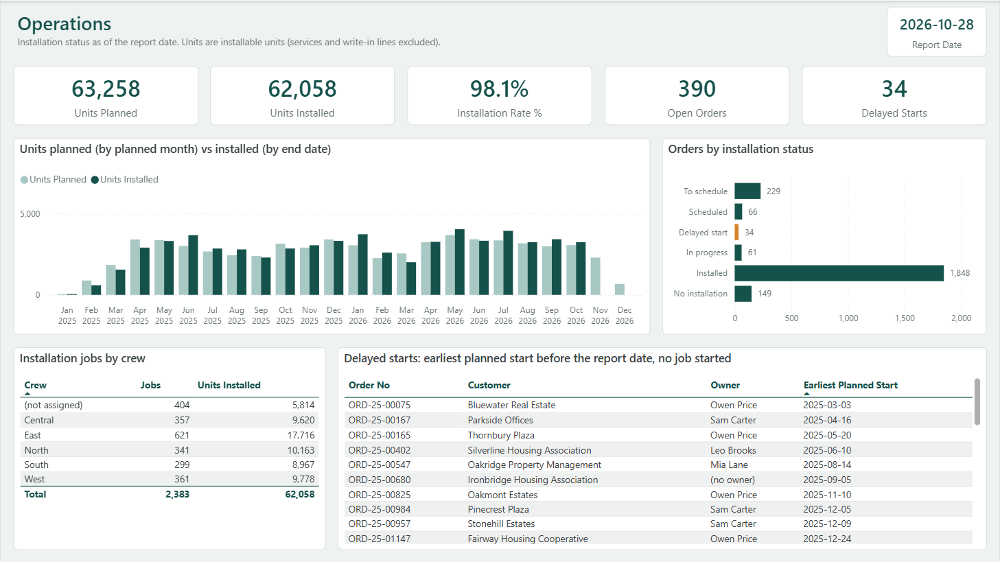
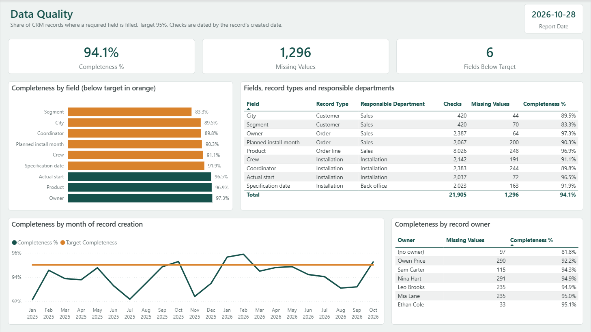
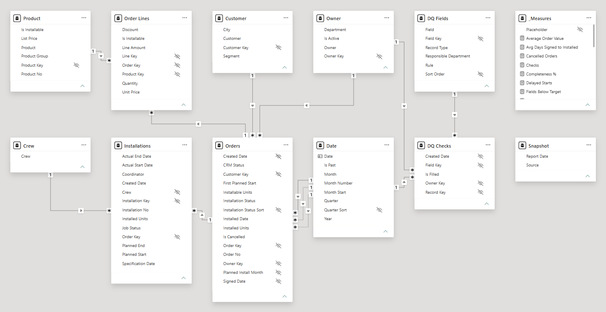

# Sales & Operations Model (Power BI)

A Power BI model and report on Dynamics 365 / Dataverse CRM data: sales, the installation plan against what was installed, and the quality of the CRM data. It is a Power BI Project (PBIP): the semantic model is written in TMDL and the report in PBIR, so every table, relationship, measure and visual is a text file that can be reviewed and diffed in Git. Every figure the model shows is checked against an independent calculation by a test that runs DAX queries in the real Power BI engine.

Power BI (DAX, Power Query M, TMDL, PBIR) with C# (.NET) and Python tooling. All data is generated demo data.



## The problem

A fictional company that sells and installs security systems and Wi-Fi in buildings in Poland keeps its orders and installation jobs in Dynamics 365. Its monthly sales and installation report is an Excel workbook that someone rebuilds by hand from CRM exports. The report is moving to Power BI, reading the CRM data itself, so that the figures come from one source and the gaps in the CRM become visible instead of being patched in Excel. The CRM data is not ready for a report:

- **Timestamps are in UTC.** Dataverse stores date-and-time columns in UTC. An order created at 00:30 in Warsaw has the previous day's date in UTC. On the last day of a month it moves to the previous month, on 1 January to the previous year.
- **Installation jobs live in a custom table.** An order can have two jobs (a split installation). A job can be cancelled and replaced, or cancelled as a duplicate instead of being deleted. Cancelling an order does not cancel its job.
- **Order lines can be write-in lines** with free text instead of a product. Services are sold but never installed.
- **Owners are missing or gone.** Some orders have no owner; some belong to a former sales manager whose CRM user is disabled.
- **Required fields are often empty:** city, segment, planned install month, crew, coordinator, actual start, specification date. Nobody knows how often, or which department should fill them.

## What the model does

- Reads seven CSV files shaped like a Dataverse export (logical column names, UTC timestamps, date-only columns) and turns them into a star schema with readable names.
- Converts every UTC timestamp to Warsaw time before it takes the date, with a fixed CET/CEST rule that does not depend on the time zone of the PC or the service.
- Sets an installation status for every order as of the report date, the local date of the export.
- Counts installed units by the date a job ended, not by the date of the order, without an ambiguous relationship.
- Checks nine CRM fields on every record where they are required and shows completeness by field, responsible department, month and owner.

## The report

Three pages, 1280 x 720, built only from standard visuals. A page header shows the report date, 2026-10-28.

| Page | Shows |
|---|---|
| Sales | Order Value, Orders, Average Order Value, YTD Growth %; order value by month with the same month a year earlier; by product group; a table by owner. Year and Owner slicers |
| Operations | Units Planned, Units Installed, Installation Rate %, Open Orders, Delayed Starts; planned vs installed units by month; orders by installation status; jobs by crew; the list of delayed starts |
| Data Quality | Completeness %, Missing Values, Fields Below Target; completeness by field (below target in orange), by field and department, by month of record creation, by owner |





## Data model



| Table | From | Rows | Notes |
|---|---|---|---|
| Orders | salesorder | 2,500 | Local created and signed dates, planned install month, CRM status, installable and installed units, installation status, installed date, first planned start |
| Order Lines | salesorderdetail | 8,410 | Quantity, unit price, discount, line amount; write-in lines point to a `(write-in)` product |
| Installations | ops_installation | 2,505 | Crew, coordinator, planned dates, local actual dates, installed units, job status, specification date |
| Customer | account | 420 | Empty city or segment shows as `(not set)` |
| Owner | systemuser | 13 | 12 users and a `(no owner)` row |
| Product | product | 25 | 24 products and a `(write-in)` row (group Other, not installable) |
| Crew | | 6 | Five crews and `(not assigned)` |
| Date | | 730 | 2025-2026, marked as the date table; month labels like `Jan 2026`; Is Past compares with the report date |
| DQ Fields | | 9 | The field catalog of the data-quality checks |
| DQ Checks | | 21,905 | One row per record and required field, with Is Filled 1 or 0 |
| Snapshot | export_info | 1 | The report date |
| _Measures | | | All 29 measures, in display folders Sales, Operations, Data quality and General |

**Relationships.** All twelve are many-to-one and filter in one direction:

| From | To | Active |
|---|---|---|
| Order Lines[Order Key] | Orders[Order Key] | yes |
| Order Lines[Product Key] | Product[Product Key] | yes |
| Orders[Customer Key] | Customer[Customer Key] | yes |
| Orders[Owner Key] | Owner[Owner Key] | yes |
| Orders[Created Date] | Date[Date] | yes |
| Orders[Signed Date] | Date[Date] | no, used with USERELATIONSHIP |
| Orders[Planned Install Month] | Date[Date] | no, used with USERELATIONSHIP |
| Installations[Order Key] | Orders[Order Key] | yes |
| Installations[Crew] | Crew[Crew] | yes |
| DQ Checks[Field Key] | DQ Fields[Field Key] | yes |
| DQ Checks[Owner Key] | Owner[Owner Key] | yes |
| DQ Checks[Created Date] | Date[Date] | yes |

Installations has no relationship to Date: a second path from Date through Orders would make the model ambiguous. Measures by installation date remove the Date filter and move its dates onto the actual end date with `REMOVEFILTERS('Date')` and `TREATAS`.

## Measures

All measures live in `_Measures`; each has a description, a display folder and a format string. R is the report date. The value is the total without filters on the demo data, from the [recorded test run](docs/test-run.txt).

| Measure | Folder | Definition | Value |
|---|---|---|---|
| Orders | Sales | Non-cancelled orders, by created date | 2,387 |
| Cancelled Orders | Sales | Orders with CRM status Canceled, by created date | 113 |
| Order Value | Sales | Sum of the line amounts of non-cancelled orders, EUR, by created date | 9,708,156.41 |
| Average Order Value | Sales | Order Value / Orders | 4,067.10 |
| Units Ordered | Sales | Quantity on installable lines of non-cancelled orders; services and write-in lines are not counted | 73,461 |
| Signed Orders | Sales | Non-cancelled orders with a signed date, by signed date (USERELATIONSHIP) | 2,206 |
| Signed Value | Sales | Order Value of signed orders, by signed date (USERELATIONSHIP) | 8,968,189.36 |
| Unsigned Orders | Sales | Non-cancelled orders without a signed date, by created date | 181 |
| Order Value PY | Sales | Order Value of the same period one year earlier (SAMEPERIODLASTYEAR); without filters this is 2025 | 5,050,945.81 |
| Order Value YTD | Sales | From 1 January of the year of the last date in the filter to that date, never past R | 4,657,210.60 |
| Order Value PY YTD | Sales | The same window one year earlier: for 2026 as of R, 1 January to 28 October 2025 | 4,105,561.15 |
| YTD Growth % | Sales | (Order Value YTD - Order Value PY YTD) / Order Value PY YTD | 13.4% |
| Units Planned | Operations | Units Ordered by planned install month (USERELATIONSHIP); orders without a planned month are not counted | 63,258 |
| Units Installed | Operations | Installed units of non-cancelled jobs of non-cancelled orders, by local actual end date, up to R | 62,058 |
| Installation Rate % | Operations | Units Installed / Units Planned | 98.1% |
| Open Orders | Operations | Non-cancelled orders with installable units whose status is not Installed | 390 |
| Delayed Starts | Operations | Orders with status Delayed start | 34 |
| Orders Installed | Operations | Orders with status Installed | 1,848 |
| Avg Days Signed to Installed | Operations | Average days from signed date to installed date, over installed orders with a signed date | 45.2 |
| Units Backlog | Operations | Installable minus installed units of signed, non-cancelled orders that are not Installed | 6,641 |
| Orders Without Owner | Operations | Non-cancelled orders of `(no owner)` | 64 |
| Jobs | Operations | Non-cancelled installation jobs; a live job of a cancelled order counts | 2,383 |
| Checks | Data quality | Rows of DQ Checks | 21,905 |
| Filled Values | Data quality | Sum of Is Filled | 20,609 |
| Missing Values | Data quality | Checks - Filled Values | 1,296 |
| Completeness % | Data quality | Filled Values / Checks | 94.1% |
| Target Completeness | Data quality | 95%, the level the business expects for every field | 95.0% |
| Fields Below Target | Data quality | Fields with checks whose Completeness % is below the target | 6 |
| Report Date | General | Local date of the CRM export (Snapshot) | 2026-10-28 |

## Installation status

Every order gets one status as of R, the first rule that applies. Only the order's non-cancelled jobs count. The column is computed in Power Query, so slicers and measures can use it like any other attribute.

| Status | Rule | Orders |
|---|---|---|
| Cancelled | The order is cancelled (CRM status Canceled) | 113 |
| No installation | No installable units: services or write-in lines only | 149 |
| Installed | Units of jobs that ended on or before R ≥ installable units | 1,848 |
| In progress | A job has started on or before R: it has an actual start, or only an actual end | 61 |
| To schedule | No job has a planned start | 229 |
| Delayed start | The earliest planned start is before R | 34 |
| Scheduled | All other orders | 66 |

Installed Date is the latest actual end of the order's jobs when the status is Installed. A completed job with only an end time counts as started: crews sometimes enter just the end, and such an order must not show up as a delayed start.

## Data quality checks

The data-quality page rests on two tables:

- **DQ Fields** is the catalog: one row per checked field with its record type, responsible department, rule and sort order.
- **DQ Checks** is the fact table: one row for every record where a field is required, with `Is Filled` = 1 or 0, the owner (of the order, or of the customer for customer fields) and the local created date of the record (an order line takes its order's).

Completeness is then `SUM(Is Filled) / COUNTROWS`, and it slices by field, department, month and owner through ordinary relationships. Adding a field means one row in the catalog and one `Check(...)` line in the DQ Checks query.

| Field | Record | Responsible | Checked on | Checks | Missing | Complete |
|---|---|---|---|---|---|---|
| City | Customer | Sales | Every customer | 420 | 44 | 89.5% |
| Segment | Customer | Sales | Every customer | 420 | 70 | 83.3% |
| Owner | Order | Sales | Every non-cancelled order | 2,387 | 64 | 97.3% |
| Planned install month | Order | Sales | Signed, non-cancelled orders with installable units | 2,067 | 200 | 90.3% |
| Product | Order line | Sales | Lines of non-cancelled orders; a write-in line counts as missing | 8,026 | 248 | 96.9% |
| Crew | Installation | Installation | Jobs that are scheduled, in progress or completed | 2,142 | 191 | 91.1% |
| Coordinator | Installation | Installation | Every non-cancelled job | 2,383 | 244 | 89.8% |
| Actual start | Installation | Installation | Jobs in progress or completed | 2,037 | 72 | 96.5% |
| Specification date | Installation | Back office | Completed jobs | 2,023 | 163 | 91.9% |

The demo data has realistic, uneven gaps. Owen Price fills the planned install month on 63% of his signed orders, the other active sales managers on 96-98%. 208 of the 244 missing coordinators are on jobs created in 2025. Completed jobs without a specification date grow from at most 5% per quarter in 2025 to 24% in Q3 2026.

## Time zone handling

Dataverse returns date-and-time columns in UTC, for example `2026-03-31T22:30:00Z`, which is 1 April in Warsaw. The model converts every timestamp before it takes the date, with its own function:

```m
// CET UTC+1; CEST UTC+2 from the last Sunday of March 01:00 UTC to the last Sunday of October 01:00 UTC
fnUtcToWarsaw = (utc as nullable datetime) as nullable datetime =>
    if utc = null then null
    else
        let
            Year = Date.Year(utc),
            LastSunday = (month as number) as datetime =>
                #datetime(Year, month, 31 - Date.DayOfWeek(#date(Year, month, 31), Day.Sunday), 1, 0, 0),
            IsSummer = utc >= LastSunday(3) and utc < LastSunday(10)
        in
            utc + #duration(0, if IsSummer then 2 else 1, 0, 0)
```

- `DateTimeZone.ToLocal` is not used: it converts to the time zone of the machine that runs the refresh. On a Polish PC it would look right, in the Power BI Service (UTC) the dates would silently stay in UTC, and on a PC in another country they would shift again.
- Date-only columns (planned start and end, specification date, planned install month) are not converted, like Dataverse "Date only" columns.
- On the demo data, 16 orders have another created date in UTC than in Warsaw. With UTC dates, 8 orders would land in the wrong month and 3 in the wrong year, EUR 48,853.02 of order value in the wrong month.

## Tested against an independent calculation

`tools/generate_data.py` first builds every record as "truth" in Python, then writes the CSV files from it like a Dataverse export. From the same truth, and separately from the M and DAX code, it calculates what the model must show and writes it to `data/expected.json`. Local dates come from Python's `zoneinfo("Europe/Warsaw")`, not from the CET/CEST rule that the M code implements, so a mistake in either one shows up as a difference.

`tools/run_tests.ps1` opens the project in Power BI Desktop, refreshes it over XMLA (TOM) and compares every figure with a DAX query (ADOMD.NET) against the engine that Desktop runs:

- every measure without filters, by year, by month, by owner, product group, segment, installation status and crew
- two filters at once, like the slicers on the Sales page: year x owner, month x owner, month x segment
- data quality by field, department, month and owner
- every row of Orders, Installations, Customer, Owner, Product and Date, and the list of delayed orders
- row counts per CSV file

The data contains the cases that break a careless model, each at least once: records within two hours of local midnight, on month and year boundaries and on all four daylight-saving switch days, and records just outside summer time that must not move. There are Polish letters, names with commas and quotes, and order-line texts with a line break inside the quoted value. There are write-in lines, orders without an owner, split, duplicated and replaced jobs, a cancelled job that had started, completed jobs with only an end time, and live jobs on cancelled orders. The generator stops when one of these cases is missing.

Result on the demo data, recorded in [docs/test-run.txt](docs/test-run.txt): **9535 checks passed, 0 failed**. The whole run takes 38 seconds: about 12 seconds for the refresh, under 2 seconds for the DAX comparisons, the rest is starting Power BI Desktop.

**Does the test catch mistakes?** `tools/run_mutants.ps1` puts 24 deliberate mistakes into the model in the running Desktop, one at a time, refreshes and runs the whole test. The model files are not changed, and the restored model passes again. Result, recorded in [docs/mutation-run.txt](docs/mutation-run.txt): **24 killed, 0 survived**. The time-zone mistakes alone:

| Mistake | Failing checks |
|---|---|
| No conversion: local date = UTC date | 451 |
| Fixed UTC+1 all year | 194 |
| Fixed UTC+2 all year | 58 |
| US summer-time dates | 57 |
| Summer time starts a week early / late | 9 / 80 |
| Summer time ends a week early / late | 8 / 51 |

The others include the CSV read as Windows-1250 (757 failing checks) or without quote handling (168), month names in the culture of a Polish PC (730), a missing USERELATIONSHIP (307) and a filter removed from the wrong table (468).

## How to run

You need Windows with Power BI Desktop (tested with 2.159, Microsoft Store version). For the tests: the .NET SDK 10 or later. For regenerating the data: Python 3.12 with `tzdata`.

### Open the report

1. Download or clone the repository.
2. Point the model at the data folder of your copy, once after cloning (Power Query needs an absolute path):

   ```powershell
   powershell -ExecutionPolicy Bypass -File tools\set_data_folder.ps1
   ```

   The repository holds the placeholder `C:\path\to\sales-operations-powerbi\data\`; the script writes the real path into `SalesOps.SemanticModel\definition\expressions.tmdl`. In a Git clone it also registers a clean filter in the clone's `.git\config`, so Git keeps storing the placeholder and `git status` stays clean. In every new clone, run the script before your first commit, even if you set the data folder in Power BI Desktop (**Transform data > Edit parameters**): the script also registers the Git filter, and without it Git stores the real path. A zip download works the same way, without Git.

3. Open `SalesOps.pbip` in Power BI Desktop and click **Home > Refresh**. A PBIP holds no data, so the tables are empty until the first refresh.

`tools\open_desktop.ps1` does steps 2 and 3 in one go: it sets the data folder, opens the project, refreshes it and prints the port of the local engine.

### Regenerate the data and test

```powershell
python -m venv .venv
.venv\Scripts\python -m pip install -r requirements.txt
.venv\Scripts\python -I tools\generate_data.py
powershell -ExecutionPolicy Bypass -File tools\run_tests.ps1
powershell -ExecutionPolicy Bypass -File tools\run_mutants.ps1
```

`run_tests.ps1` first checks the model offline (`ModelTool validate`): the TMDL loads, every measure has a description, a display folder and a format string and sits in `_Measures`, keys are hidden, no relationship is bidirectional or many-to-many, the date table is marked, auto date/time is off, and no query both reads a file and combines other queries. It closes the Desktop it opened; `-KeepOpen` leaves it open, `-Port <port>` reuses a running one.

Other commands:

```powershell
# rewrite the PBIR report from its source
.venv\Scripts\python -I tools\build_report.py
# run a DAX query from a file against a running Desktop (PORT printed by open_desktop.ps1)
tools\ModelTool\bin\Release\net10.0\ModelTool.exe query <port> "@C:\path\to\query.dax"
```

## Project structure

```
sales-operations-powerbi/
├── SalesOps.pbip                  open this in Power BI Desktop
├── SalesOps.SemanticModel/
│   ├── definition/                TMDL: model, relationships, expressions (M queries), one file per table
│   └── diagramLayout.json         table positions in the Model view
├── SalesOps.Report/
│   ├── definition/                PBIR: report.json, pages, one visual.json per visual
│   └── StaticResources/           base theme and the custom SalesOps theme
├── data/                          generated CSV export and expected.json
├── docs/                          screenshots, recorded test and mutation runs
└── tools/
    ├── generate_data.py           demo export and expected figures
    ├── build_report.py            writes the PBIR report (the source of the report)
    ├── set_data_folder.ps1        writes the data folder into the DataFolder parameter, registers the Git filter
    ├── open_desktop.ps1           opens the project in Desktop and refreshes it
    ├── run_tests.ps1              validation and golden-master test
    ├── run_mutants.ps1            mutation run with mutants.json
    ├── shared.ps1                 helpers of the scripts
    └── ModelTool/                 C# console tool: validate, refresh, query, test, mutants
```

## Technical notes

- **Model and report as text.** TMDL and PBIR are the Git-friendly formats of a Power BI Project. The model and the report were written as text, not clicked together, and the scripts never need the Desktop UI: they refresh the model over XMLA (TOM) and query it with ADOMD.NET against the engine that Desktop starts on a local port. Desktop is controlled through UI Automation only, to close its first-run tips.
- **Star schema, single direction.** Four fact tables (Orders, Order Lines, Installations, DQ Checks), dimensions on the one side, no bidirectional or many-to-many relationships. The role-playing dates of Orders use inactive relationships and USERELATIONSHIP instead of extra date tables.
- **No auto date/time.** The model has its own Date table, marked as the date table, and `__PBI_TimeIntelligenceEnabled = 0`, so Power BI creates no hidden date tables for every date column.
- **Measure table.** The measures live in `_Measures`, not `Measures`: Power BI Desktop does not open a model with a table named `Measures`. Implicit measures are discouraged, so every number on the report is an explicit, described measure.
- **Best-practice validator.** `ModelTool validate` checks the rules above offline, so a rule broken in a text edit fails before Desktop is even opened.
- **Formula firewall.** With privacy levels on, Power Query refuses a query that both reads a data source and combines other queries. Each CSV file is therefore read in a query of its own (`rawOrderLines`, `rawInstallations`, ...), and other queries only combine them. The model ignores privacy levels for speed (`fastCombine`), but it also refreshes with privacy levels on.
- **Locale.** Every column is typed with the `en-US` culture and month names are built with `en-US`, so the model gives the same result on a Polish or any other non-English Windows. Visual titles are set explicitly; otherwise Desktop creates them in the language of its interface.
- **Saving in Desktop.** The TMDL files have no `lineageTag` properties. When Power BI Desktop saves the project it adds them, plus a `cultures/en-US.tmdl` file and `.platform` files: one large but harmless diff.
- **Data folder in Git.** Power Query needs an absolute path, so the DataFolder parameter holds a path of the PC, which does not belong in the repository. `.gitattributes` gives `expressions.tmdl` the clean filter `datafolder`, and `set_data_folder.ps1` registers it in the local `.git\config`: whenever Git reads the file (`git add`, `git diff`, `git status`), `sed` from Git for Windows replaces only the DataFolder literal with the placeholder, whatever follows it on the line. The commit holds the placeholder, the file on disk keeps the real path. The filter is `required`, so if sed cannot run, `git add` fails instead of storing the path. Git takes a file of another size than in its index as changed without running the filter, so after writing the path the script refreshes the index entry when the filtered file is the same as the one in the index; a real edit of the file stays unstaged and visible. A checkout or pull that rewrites the file brings the placeholder back; `set_data_folder.ps1` writes the path again (`run_tests.ps1` and `open_desktop.ps1` run it first). A clone does not copy `.git\config`, so the filter works only after the script has run in that clone. If the file was added before, `set_data_folder.ps1` warns and `run_tests.ps1` fails when the Git index or the last commit holds anything other than the placeholder. `.gitignore` also leaves out `.pbi/unappliedChanges.json`, where Desktop keeps Power Query edits that are not applied yet.
- **Line endings.** `.gitattributes` fixes them whatever `core.autocrlf` is: the repository stores text with LF, scripts and C# files are checked out with CRLF; Python, Markdown and the JSON files that the Python tools write (`data/expected.json` and the report) with LF, so a rebuild leaves `git status` clean. The CSV files are stored byte for byte (`-text`): their rows end with CRLF, and some order-line texts contain a bare LF inside a quoted value that line-end conversion would turn into CRLF.
- **Report source.** `tools/build_report.py` writes the whole PBIR report. Change the report there and run it again, or edit and save it in Desktop and stop using the script.
- Built with AI-assisted development (Claude Code). Every figure is checked by the golden-master test above.

## Demo data

All companies, people and numbers are generated by `tools/generate_data.py` with a fixed seed. The company, its customers and its staff are fictional. The CSV files imitate the logical column names of a Dataverse export; the `ops_` columns and the `ops_installation` table stand for the custom fields and the custom table of such a system.

## License

Portfolio project. You may view the code and open the model to evaluate it. Reuse, redistribution or resale is not permitted without written permission. Copyright (c) 2026 Denys Zaitsev. All rights reserved.

For permission or custom work: denys.zaitsev.work@gmail.com
